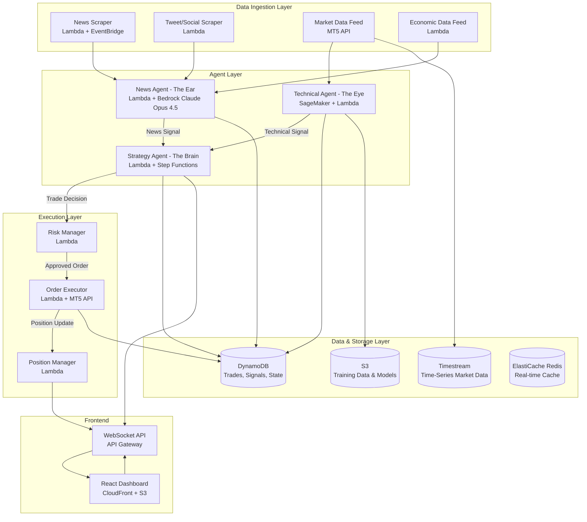
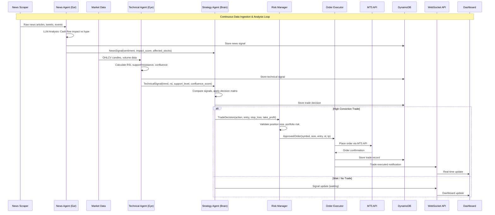
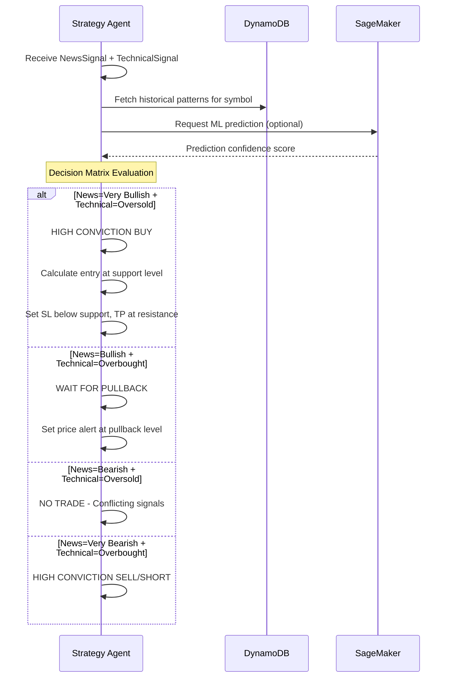

# Design Document: AI-Powered Multi-Agent Trading System

## Overview

This system is an AI-powered multi-agent trading platform that connects to an Exness trading account to execute intelligent stock trades. It employs three specialized agents — a News Agent ("The Ear"), a Technical Agent ("The Eye"), and a Strategy Agent ("The Brain") — that collaborate to analyze market conditions, build trading strategies, and execute trades with calculated entry/exit points, stop-loss, and take-profit levels.

The platform ingests diverse data sources including live news feeds, CEO tweets, global economic events, and technical chart data. Each agent processes its domain-specific data and feeds signals to the Strategy Agent, which synthesizes them into high-conviction trade decisions. The system supports both short-term (5-day) and long-term (6-month) trading horizons, aiming for 80%+ trade success rate by mimicking the decision-making patterns of experienced traders. A React-based frontend dashboard provides real-time monitoring of all agent activities, trade positions, and performance metrics.

The infrastructure runs on AWS, leveraging SageMaker for ML model training and inference, Lambda for event-driven processing, and DynamoDB/S3 for data persistence. The Exness integration via MetaTrader 5 (MT5) API handles order execution, position management, and account monitoring.

## Architecture



## Sequence Diagrams

### Main Trading Flow



### Strategy Decision Flow




## Components and Interfaces

### Component 1: News Agent (The Ear)

**Purpose**: Scrapes live news, CEO tweets, and global events, then uses Claude Opus 4.5 via AWS Bedrock to determine whether news has genuine cash-flow impact on stocks or is merely hype.

**Interface**:
```python
from dataclasses import dataclass
from enum import Enum
from typing import Optional
from datetime import datetime

class Sentiment(Enum):
    VERY_BULLISH = "very_bullish"
    BULLISH = "bullish"
    NEUTRAL = "neutral"
    BEARISH = "bearish"
    VERY_BEARISH = "very_bearish"

class ImpactType(Enum):
    CASH_FLOW = "cash_flow"       # Direct financial impact
    HYPE = "hype"                  # Market sentiment only
    REGULATORY = "regulatory"      # Regulatory/legal impact
    MACRO = "macro"                # Macroeconomic impact

@dataclass
class NewsItem:
    source: str                    # "reuters", "twitter", "sec_filing"
    headline: str
    content: str
    published_at: datetime
    symbols: list[str]             # Affected stock symbols
    url: Optional[str] = None

@dataclass
class NewsSignal:
    symbol: str
    sentiment: Sentiment
    impact_type: ImpactType
    impact_score: float            # 0.0 to 1.0
    confidence: float              # 0.0 to 1.0
    reasoning: str                 # LLM explanation
    source_items: list[str]        # Source news item IDs
    timestamp: datetime
    expires_at: datetime           # Signal validity window

class NewsAgentInterface:
    async def analyze_news(self, items: list[NewsItem]) -> list[NewsSignal]: ...
    async def get_latest_signals(self, symbol: str, limit: int = 10) -> list[NewsSignal]: ...
    async def get_aggregate_sentiment(self, symbol: str) -> Sentiment: ...
```

**Responsibilities**:
- Scrape news from multiple sources (Reuters, Bloomberg, SEC filings, Twitter/X)
- Filter and deduplicate news items per symbol
- Use Claude Opus 4.5 via AWS Bedrock to classify impact type (cash flow vs hype)
- Generate sentiment scores with confidence levels
- Expire stale signals based on time windows

### Component 2: Technical Agent (The Eye)

**Purpose**: Reads charts, calculates technical indicators (RSI, support/resistance, volume), and identifies confluence patterns. Uses SageMaker for pattern recognition on historical data.

**Interface**:
```python
from dataclasses import dataclass
from enum import Enum

class TrendDirection(Enum):
    STRONG_UPTREND = "strong_uptrend"
    UPTREND = "uptrend"
    SIDEWAYS = "sideways"
    DOWNTREND = "downtrend"
    STRONG_DOWNTREND = "strong_downtrend"

class MarketCondition(Enum):
    OVERSOLD = "oversold"
    NEUTRAL = "neutral"
    OVERBOUGHT = "overbought"

@dataclass
class OHLCV:
    timestamp: datetime
    open: float
    high: float
    low: float
    close: float
    volume: int

@dataclass
class SupportResistance:
    level: float
    strength: float              # 0.0 to 1.0 (how many times tested)
    timeframe: str               # "5y", "1y", "6m", "1m"
    last_tested: datetime

@dataclass
class ConfluenceResult:
    score: float                 # 0.0 to 1.0
    factors: list[str]           # e.g. ["rsi_oversold", "5y_support", "volume_spike"]
    description: str

@dataclass
class TechnicalSignal:
    symbol: str
    trend: TrendDirection
    condition: MarketCondition
    rsi: float                   # 0-100
    current_price: float
    support_levels: list[SupportResistance]
    resistance_levels: list[SupportResistance]
    confluence: ConfluenceResult
    volume_trend: str            # "increasing", "decreasing", "stable"
    interest_rate_impact: float  # -1.0 to 1.0
    timestamp: datetime

class TechnicalAgentInterface:
    async def analyze_symbol(self, symbol: str, timeframe: str = "1d") -> TechnicalSignal: ...
    async def get_confluence(self, symbol: str) -> ConfluenceResult: ...
    async def calculate_indicators(self, candles: list[OHLCV]) -> dict: ...
    async def predict_pattern(self, symbol: str) -> dict: ...  # SageMaker inference
```

**Responsibilities**:
- Fetch and process OHLCV market data from Exness via MT5
- Calculate technical indicators (RSI, MACD, Bollinger Bands, moving averages)
- Identify multi-timeframe support and resistance levels (up to 5-year history)
- Detect confluence patterns (multiple indicators aligning)
- Use SageMaker models for chart pattern recognition
- Factor in interest rate data and macroeconomic indicators

### Component 3: Strategy Agent (The Brain)

**Purpose**: Synthesizes signals from the News Agent and Technical Agent, applies a decision matrix, and produces trade decisions with precise entry, exit, stop-loss, and take-profit calculations.

**Interface**:
```python
from dataclasses import dataclass
from enum import Enum

class TradeAction(Enum):
    STRONG_BUY = "strong_buy"
    BUY = "buy"
    WAIT_PULLBACK = "wait_pullback"
    HOLD = "hold"
    SELL = "sell"
    STRONG_SELL = "strong_sell"
    NO_TRADE = "no_trade"

class TradingHorizon(Enum):
    SHORT_TERM = "short_term"    # ~5 days
    MEDIUM_TERM = "medium_term"  # ~1-3 months
    LONG_TERM = "long_term"      # ~6 months

class Conviction(Enum):
    HIGH = "high"                # 80%+ confidence
    MEDIUM = "medium"            # 60-80% confidence
    LOW = "low"                  # Below 60%

@dataclass
class TradeDecision:
    symbol: str
    action: TradeAction
    conviction: Conviction
    horizon: TradingHorizon
    entry_price: float
    stop_loss: float
    take_profit: float
    position_size_pct: float     # % of portfolio
    risk_reward_ratio: float
    reasoning: str
    news_signal: NewsSignal
    technical_signal: TechnicalSignal
    timestamp: datetime
    expires_at: datetime

@dataclass
class StrategyPerformance:
    total_trades: int
    winning_trades: int
    win_rate: float
    avg_risk_reward: float
    max_drawdown: float
    sharpe_ratio: float

class StrategyAgentInterface:
    async def evaluate(self, news: NewsSignal, technical: TechnicalSignal) -> TradeDecision: ...
    async def calculate_position(self, decision: TradeDecision, portfolio: dict) -> float: ...
    async def get_performance(self, period: str = "30d") -> StrategyPerformance: ...
    async def backtest(self, symbol: str, start: datetime, end: datetime) -> StrategyPerformance: ...
```

**Responsibilities**:
- Combine news and technical signals using weighted decision matrix
- Calculate optimal entry points based on support levels and momentum
- Set stop-loss below key support levels with buffer
- Set take-profit at resistance levels or based on risk-reward ratio
- Adjust position sizing based on conviction level and portfolio risk
- Support both short-term (5-day) and long-term (6-month) horizons
- Track and learn from historical trade performance

### Component 4: Risk Manager

**Purpose**: Validates trade decisions against portfolio risk constraints before execution.

**Interface**:
```python
@dataclass
class RiskLimits:
    max_position_pct: float = 0.05       # Max 5% per position
    max_portfolio_risk_pct: float = 0.02  # Max 2% portfolio risk per trade
    max_correlated_exposure: float = 0.20  # Max 20% in correlated assets
    max_daily_loss_pct: float = 0.05      # Max 5% daily loss
    max_open_positions: int = 10

@dataclass
class RiskAssessment:
    approved: bool
    adjusted_size: Optional[float]
    risk_score: float              # 0.0 to 1.0
    warnings: list[str]
    rejection_reason: Optional[str]

class RiskManagerInterface:
    async def assess_trade(self, decision: TradeDecision, portfolio: dict) -> RiskAssessment: ...
    async def get_portfolio_risk(self) -> dict: ...
    async def check_daily_limits(self) -> bool: ...
```

### Component 5: Order Executor

**Purpose**: Interfaces with the Exness trading account via MetaTrader 5 (MT5) API to place, modify, and close orders.

**Interface**:
```python
@dataclass
class OrderResult:
    order_id: str
    symbol: str
    status: str                  # "filled", "partial", "rejected"
    filled_price: float
    filled_quantity: float
    timestamp: datetime

class OrderExecutorInterface:
    async def place_order(self, decision: TradeDecision, size: float) -> OrderResult: ...
    async def modify_order(self, order_id: str, stop_loss: float = None, take_profit: float = None) -> bool: ...
    async def close_position(self, order_id: str) -> OrderResult: ...
    async def get_open_positions(self) -> list[dict]: ...
    async def get_account_info(self) -> dict: ...
```

## Data Models

### Trade Record

```python
@dataclass
class TradeRecord:
    trade_id: str
    symbol: str
    action: TradeAction
    horizon: TradingHorizon
    entry_price: float
    exit_price: Optional[float]
    stop_loss: float
    take_profit: float
    position_size: float
    status: str                  # "open", "closed_profit", "closed_loss", "closed_sl", "closed_tp"
    pnl: Optional[float]
    pnl_pct: Optional[float]
    conviction: Conviction
    news_signal_id: str
    technical_signal_id: str
    decision_reasoning: str
    opened_at: datetime
    closed_at: Optional[datetime]
    exness_order_id: str
```

**Validation Rules**:
- `stop_loss` must be below `entry_price` for BUY, above for SELL
- `take_profit` must be above `entry_price` for BUY, below for SELL
- `position_size` must not exceed `RiskLimits.max_position_pct` of portfolio
- `risk_reward_ratio` (|tp - entry| / |sl - entry|) must be >= 1.5

### Market Data Cache

```python
@dataclass
class MarketDataCache:
    symbol: str
    timeframe: str               # "1m", "5m", "1h", "1d", "1w"
    candles: list[OHLCV]
    last_updated: datetime
    indicators: dict             # Pre-calculated indicators
```

### Agent Signal Log

```python
@dataclass
class SignalLog:
    signal_id: str
    agent_type: str              # "news", "technical", "strategy"
    symbol: str
    signal_data: dict            # Full signal payload
    created_at: datetime
    consumed_by: Optional[str]   # Which agent consumed this signal
    resulted_in_trade: bool
    trade_id: Optional[str]
```

## Algorithmic Pseudocode

### News Analysis Algorithm

```python
async def analyze_news_impact(news_item: NewsItem) -> NewsSignal:
    """
    Uses Claude Opus 4.5 via AWS Bedrock to determine if news has genuine cash-flow impact.
    
    Preconditions:
        - news_item.content is non-empty
        - news_item.symbols contains at least one valid stock symbol
        - AWS Bedrock Claude Opus 4.5 endpoint is available
    
    Postconditions:
        - Returns NewsSignal with impact_score in [0.0, 1.0]
        - Returns NewsSignal with confidence in [0.0, 1.0]
        - impact_type is CASH_FLOW only if LLM identifies direct financial impact
        - reasoning contains LLM's explanation for the classification
    """
    # Step 1: Build analysis prompt with context
    prompt = build_analysis_prompt(
        headline=news_item.headline,
        content=news_item.content,
        symbols=news_item.symbols,
        source=news_item.source
    )
    
    # Step 2: Query Claude Opus 4.5 via AWS Bedrock for impact analysis
    llm_response = await bedrock_client.invoke_model(
        modelId="anthropic.claude-opus-4-5-20250514",
        body=json.dumps({
            "anthropic_version": "bedrock-2023-05-31",
            "max_tokens": 1024,
            "messages": [{"role": "user", "content": prompt}],
            "system":
        system="You are a senior financial analyst with 10+ years experience. "
               "Determine if this news directly impacts the company's cash flow, "
               "revenue, or fundamental value — or if it's just market hype."
    )
    
    # Step 3: Parse structured response
    analysis = parse_llm_response(llm_response)
    
    # Step 4: Calculate signal expiry based on impact type
    if analysis.impact_type == ImpactType.CASH_FLOW:
        expiry_hours = 72   # Cash flow news stays relevant longer
    elif analysis.impact_type == ImpactType.REGULATORY:
        expiry_hours = 168  # Regulatory news: 1 week
    else:
        expiry_hours = 24   # Hype fades quickly
    
  
    # Step 5: Build and return signal
    return NewsSignal(
        symbol=news_item.symbols[0],
        sentiment=analysis.sentiment,
        impact_type=analysis.impact_type,
        impact_score=analysis.impact_score,
        confidence=analysis.confidence,
        reasoning=analysis.reasoning,
        source_items=[news_item.id],
        timestamp=datetime.utcnow(),
        expires_at=datetime.utcnow() + timedelta(hours=expiry_hours)
    )
```

### Confluence Detection Algorithm

```python
async def detect_confluence(symbol: str, candles: list[OHLCV]) -> ConfluenceResult:
    """
    Identifies confluence of multiple technical factors.
    Expert logic: Don't trade on a single indicator — trade when multiple align.
    
    Preconditions:
        - candles contains at least 200 data points (for 200-day MA)
        - candles are sorted by timestamp ascending
        - All candle prices are positive floats
    
    Postconditions:
        - confluence.score in [0.0, 1.0]
        - confluence.factors contains only verified factor names
        - score >= 0.7 requires at least 3 aligned factors
    
    Loop Invariants:
        - factors list only contains confirmed (True) indicators
        - score is recalculated as len(factors) / total_checks after each check
    """
    factors = []
    total_checks = 6
    
    # Check 1: RSI oversold/overbought
    rsi = calculate_rsi(candles, period=14)
    if rsi <= 30:
        factors.append("rsi_oversold")
    elif rsi >= 70:
        factors.append("rsi_overbought")
    
    # Check 2: Price at multi-year support/resistance
    support_levels = find_support_levels(candles, lookback_years=5)
    current_price = candles[-1].close
    for level in support_levels:
        if abs(current_price - level.level) / level.level < 0.02:  # Within 2%
            factors.append(f"{level.timeframe}_support")
            break
    
    # Check 3: Volume confirmation
    avg_volume = sum(c.volume for c in candles[-20:]) / 20
    current_volume = candles[-1].volume
    if current_volume > avg_volume * 1.5:
        factors.append("volume_spike")
    
    # Check 4: Moving average alignment
    ma_50 = calculate_ma(candles, 50)
    ma_200 = calculate_ma(candles, 200)
    if ma_50 > ma_200:
        factors.append("golden_cross")
    elif ma_50 < ma_200:
        factors.append("death_cross")
    
    # Check 5: MACD signal
    macd, signal_line = calculate_macd(candles)
    if macd > signal_line:
        factors.append("macd_bullish")
    elif macd < signal_line:
        factors.append("macd_bearish")
    
    # Check 6: Bollinger Band position
    upper, middle, lower = calculate_bollinger(candles)
    if current_price <= lower:
        factors.append("below_bollinger_lower")
    elif current_price >= upper:
        factors.append("above_bollinger_upper")
    
    score = len(factors) / total_checks
    
    return ConfluenceResult(
        score=score,
        factors=factors,
        description=f"Confluence: {len(factors)}/{total_checks} factors aligned"
    )
```

### Strategy Decision Algorithm

```python
async def evaluate_trade(
    news: NewsSignal,
    technical: TechnicalSignal,
    horizon: TradingHorizon
) -> TradeDecision:
    """
    Core decision engine: compares news and technical signals to produce trade decisions.
    
    Preconditions:
        - news.symbol == technical.symbol
        - news.timestamp and technical.timestamp are within 1 hour of each other
        - news.expires_at > datetime.utcnow() (signal still valid)
        - technical.rsi in [0, 100]
    
    Postconditions:
        - If action is STRONG_BUY or STRONG_SELL, conviction must be HIGH
        - stop_loss is always set (never zero)
        - risk_reward_ratio >= 1.5 for any actionable trade
        - position_size_pct <= RiskLimits.max_position_pct
        - entry_price is based on current market price or limit at support
    
    Loop Invariants: N/A (decision matrix, no loops)
    """
    symbol = news.symbol
    
    # Step 1: Map signals to decision matrix inputs
    news_score = _map_sentiment_score(news.sentiment, news.impact_score)
    tech_score = _map_technical_score(technical.condition, technical.confluence.score)
    
    # Step 2: Apply decision matrix
    #   News Very Bullish + Tech Oversold    → STRONG_BUY  (High Conviction)
    #   News Bullish + Tech Overbought       → WAIT_PULLBACK
    #   News Bearish + Tech Oversold         → NO_TRADE (conflicting)
    #   News Very Bearish + Tech Overbought  → STRONG_SELL (High Conviction)
    
    combined_score = (news_score * 0.4) + (tech_score * 0.6)  # Technical weighted higher
    
    if news.sentiment in (Sentiment.VERY_BULLISH,) and technical.condition == MarketCondition.OVERSOLD:
        action = TradeAction.STRONG_BUY
        conviction = Conviction.HIGH
    elif news.sentiment in (Sentiment.BULLISH,) and technical.condition == MarketCondition.OVERBOUGHT:
        action = TradeAction.WAIT_PULLBACK
        conviction = Conviction.MEDIUM
    elif news.sentiment in (Sentiment.VERY_BEARISH,) and technical.condition == MarketCondition.OVERBOUGHT:
        action = TradeAction.STRONG_SELL
        conviction = Conviction.HIGH
    elif combined_score > 0.6:
        action = TradeAction.BUY
        conviction = Conviction.MEDIUM
    elif combined_score < -0.6:
        action = TradeAction.SELL
        conviction = Conviction.MEDIUM
    else:
        action = TradeAction.NO_TRADE
        conviction = Conviction.LOW
    
    # Step 3: Calculate entry, stop-loss, take-profit
    entry, sl, tp = _calculate_levels(
        action=action,
        current_price=technical.current_price,
        support_levels=technical.support_levels,
        resistance_levels=technical.resistance_levels,
        horizon=horizon
    )
    
    # Step 4: Calculate position size based on conviction and risk
    position_pct = _calculate_position_size(conviction, sl, entry)
    rr_ratio = abs(tp - entry) / abs(sl - entry) if abs(sl - entry) > 0 else 0
    
    return TradeDecision(
        symbol=symbol,
        action=action,
        conviction=conviction,
        horizon=horizon,
        entry_price=entry,
        stop_loss=sl,
        take_profit=tp,
        position_size_pct=position_pct,
        risk_reward_ratio=rr_ratio,
        reasoning=f"News: {news.sentiment.value}, Tech: {technical.condition.value}, "
                  f"Confluence: {technical.confluence.score:.2f}",
        news_signal=news,
        technical_signal=technical,
        timestamp=datetime.utcnow(),
        expires_at=datetime.utcnow() + timedelta(hours=4)
    )
```

## Key Functions with Formal Specifications

### Function: calculate_stop_loss()

```python
def calculate_stop_loss(
    action: TradeAction,
    entry_price: float,
    support_levels: list[SupportResistance],
    horizon: TradingHorizon
) -> float:
```

**Preconditions:**
- `entry_price > 0`
- `action` is either BUY/STRONG_BUY or SELL/STRONG_SELL
- `support_levels` is sorted by level ascending
- At least one support/resistance level exists

**Postconditions:**
- For BUY: `0 < stop_loss < entry_price`
- For SELL: `stop_loss > entry_price`
- Stop-loss is placed below nearest support (BUY) or above nearest resistance (SELL)
- Buffer of 0.5-2% applied below support to avoid false triggers
- Short-term horizon uses tighter stops than long-term

**Loop Invariants:**
- When iterating support levels: `candidate_sl <= entry_price` for BUY actions

### Function: calculate_take_profit()

```python
def calculate_take_profit(
    action: TradeAction,
    entry_price: float,
    stop_loss: float,
    resistance_levels: list[SupportResistance],
    horizon: TradingHorizon,
    min_rr_ratio: float = 1.5
) -> float:
```

**Preconditions:**
- `entry_price > 0` and `stop_loss > 0`
- `min_rr_ratio >= 1.5`
- For BUY: `stop_loss < entry_price`
- For SELL: `stop_loss > entry_price`

**Postconditions:**
- For BUY: `take_profit > entry_price`
- For SELL: `take_profit < entry_price`
- `|take_profit - entry_price| / |stop_loss - entry_price| >= min_rr_ratio`
- Take-profit aligns with nearest resistance level when possible
- Long-term horizon targets higher resistance levels

### Function: calculate_rsi()

```python
def calculate_rsi(candles: list[OHLCV], period: int = 14) -> float:
```

**Preconditions:**
- `len(candles) >= period + 1`
- All `candle.close > 0`
- `period > 0`

**Postconditions:**
- `0 <= rsi <= 100`
- `rsi < 30` indicates oversold
- `rsi > 70` indicates overbought
- Uses Wilder's smoothing method

**Loop Invariants:**
- `avg_gain >= 0` and `avg_loss >= 0` at each iteration
- Running averages use previous period's smoothed values

### Function: assess_trade_risk()

```python
async def assess_trade_risk(
    decision: TradeDecision,
    portfolio: dict,
    risk_limits: RiskLimits
) -> RiskAssessment:
```

**Preconditions:**
- `decision.position_size_pct > 0`
- `portfolio["total_value"] > 0`
- `portfolio["open_positions"]` is a valid list
- `risk_limits` has all fields set to positive values

**Postconditions:**
- If `approved == True`: position passes all risk checks
- If `approved == False`: `rejection_reason` is non-empty
- `adjusted_size` is set if original size exceeds limits but trade is still viable
- `risk_score` in [0.0, 1.0] where 1.0 = maximum risk

**Loop Invariants:**
- When checking correlated exposure: running total never exceeds portfolio value

## Example Usage

```python
import asyncio
from datetime import datetime

# Example 1: Full trading pipeline
async def main_trading_loop():
    news_agent = NewsAgent(bedrock_client=bedrock_runtime_client)
    tech_agent = TechnicalAgent(sagemaker_endpoint="trading-model-v1")
    strategy_agent = StrategyAgent()
    risk_manager = RiskManager(limits=RiskLimits())
    executor = OrderExecutor(exness_api_key="...")

    symbol = "AAPL"

    # Fetch and analyze news
    raw_news = await news_agent.scrape_latest(symbol)
    news_signal = await news_agent.analyze_news(raw_news)
    # NewsSignal(symbol="AAPL", sentiment=VERY_BULLISH, impact_type=CASH_FLOW,
    #            impact_score=0.85, confidence=0.9)

    # Analyze technicals
    tech_signal = await tech_agent.analyze_symbol(symbol, timeframe="1d")
    # TechnicalSignal(symbol="AAPL", condition=OVERSOLD, rsi=28.5,
    #                 confluence=ConfluenceResult(score=0.83, factors=["rsi_oversold", "5y_support", ...]))

    # Strategy decision
    decision = await strategy_agent.evaluate(news_signal, tech_signal)
    # TradeDecision(action=STRONG_BUY, conviction=HIGH, entry=150.25,
    #              stop_loss=147.50, take_profit=162.00, risk_reward=4.27)

    # Risk check
    portfolio = await executor.get_account_info()
    risk = await risk_manager.assess_trade(decision, portfolio)

    if risk.approved:
        result = await executor.place_order(decision, risk.adjusted_size or decision.position_size_pct)
        print(f"Order placed: {result.order_id} at {result.filled_price}")
    else:
        print(f"Trade rejected: {risk.rejection_reason}")

# Example 2: Conflicting signals — system waits
async def conflicting_signal_example():
    # News is bullish but technical shows overbought
    news = NewsSignal(symbol="TSLA", sentiment=Sentiment.BULLISH,
                      impact_type=ImpactType.HYPE, impact_score=0.6, ...)
    tech = TechnicalSignal(symbol="TSLA", condition=MarketCondition.OVERBOUGHT,
                           rsi=75.2, confluence=ConfluenceResult(score=0.3, ...))

    decision = await strategy_agent.evaluate(news, tech)
    # TradeDecision(action=WAIT_PULLBACK, conviction=MEDIUM)
    # System sets a price alert and does NOT execute a trade

# Example 3: Dashboard WebSocket update
async def push_dashboard_update(decision: TradeDecision):
    await websocket_api.broadcast({
        "type": "trade_signal",
        "symbol": decision.symbol,
        "action": decision.action.value,
        "conviction": decision.conviction.value,
        "entry": decision.entry_price,
        "stop_loss": decision.stop_loss,
        "take_profit": decision.take_profit,
        "reasoning": decision.reasoning,
        "timestamp": decision.timestamp.isoformat()
    })
```

## Correctness Properties

The following properties must hold for all valid inputs:

1. **Stop-Loss Integrity**: For all BUY trades, `stop_loss < entry_price`. For all SELL trades, `stop_loss > entry_price`. No trade is ever placed without a stop-loss.

2. **Risk-Reward Minimum**: For all executed trades, `risk_reward_ratio >= 1.5`. The system never enters a trade where potential loss exceeds 2/3 of potential gain.

3. **Position Size Limits**: For all trades, `position_size_pct <= max_position_pct`. No single trade risks more than the configured maximum percentage of the portfolio.

4. **Signal Freshness**: For all trade decisions, both `news_signal.expires_at > decision.timestamp` and `technical_signal.timestamp` is within 1 hour of `decision.timestamp`. Stale signals are never used for trade decisions.

5. **Confluence Threshold**: For all HIGH conviction trades, `technical.confluence.score >= 0.5` with at least 3 aligned factors. The system never assigns high conviction based on a single indicator.

6. **Decision Matrix Consistency**: If `news.sentiment == VERY_BULLISH` and `technical.condition == OVERSOLD`, then `action` must be `STRONG_BUY` or `BUY`. Conflicting strong signals (e.g., very bearish news + oversold technical) result in `NO_TRADE`.

7. **Daily Loss Limit**: The sum of all realized losses in a calendar day never exceeds `max_daily_loss_pct` of portfolio value. Once hit, no new trades are opened until the next trading day.

8. **RSI Bounds**: For all RSI calculations, `0 <= rsi <= 100`. RSI values outside this range indicate a calculation error.

9. **News Impact Classification**: If `impact_type == CASH_FLOW`, then `confidence >= 0.7`. Low-confidence cash-flow classifications are downgraded to HYPE.

10. **Portfolio Exposure**: The total value of all open positions never exceeds the portfolio's total available margin. Correlated asset exposure never exceeds `max_correlated_exposure`.

## Error Handling

### Error Scenario 1: MT5 API Connection Failure

**Condition**: MT5 API returns connection timeout or error during order placement
**Response**: Retry with exponential backoff (3 attempts, 1s/2s/4s delays). Log the failure. Do NOT retry if the order may have been partially filled.
**Recovery**: Query open positions to verify state. Alert dashboard via WebSocket. Queue the trade decision for manual review.

### Error Scenario 2: Stale Market Data

**Condition**: Market data feed has not updated for > 5 minutes during trading hours
**Response**: Mark Technical Agent signals as stale. Halt new trade decisions. Continue monitoring existing positions with last known stop-loss/take-profit.
**Recovery**: Reconnect to MT5. Once fresh data resumes, recalculate all active signals before resuming trading.

### Error Scenario 3: LLM API Failure (AWS Bedrock Claude Opus 4.5)

**Condition**: AWS Bedrock Claude Opus 4.5 returns error or timeout during news analysis
**Response**: Fall back to rule-based sentiment analysis using keyword matching. Mark news signals with `confidence *= 0.5` to indicate reduced reliability.
**Recovery**: Retry LLM analysis on next scheduled run. Log degraded mode for dashboard alerting.

### Error Scenario 4: Risk Limit Breach

**Condition**: Portfolio daily loss exceeds `max_daily_loss_pct` threshold
**Response**: Immediately halt all new trade openings. Keep existing stop-losses active. Send critical alert to dashboard and optional SMS/email notification.
**Recovery**: Automatically resume trading at start of next trading day. Require manual override for same-day resumption.

### Error Scenario 5: SageMaker Inference Failure

**Condition**: SageMaker endpoint returns error or latency > 10s
**Response**: Skip ML-based pattern prediction. Technical Agent continues with traditional indicator calculations only. Mark confluence score with reduced weight for ML factor.
**Recovery**: Health-check SageMaker endpoint. Retry on next analysis cycle.

## Testing Strategy

### Unit Testing Approach

- Test each agent in isolation with mocked dependencies
- News Agent: Mock AWS Bedrock Claude Opus 4.5 responses, verify sentiment classification and impact scoring
- Technical Agent: Use known OHLCV datasets with pre-calculated expected RSI, MACD, support/resistance values
- Strategy Agent: Test all decision matrix combinations (sentiment × market condition) with expected outcomes
- Risk Manager: Test position sizing, daily loss limits, and correlated exposure calculations
- Target: 90%+ code coverage on core logic

### Property-Based Testing Approach

**Property Test Library**: Hypothesis (Python)

Key properties to test:
- RSI always returns values in [0, 100] for any valid candle sequence
- Stop-loss is always on the correct side of entry price for any trade action
- Risk-reward ratio is always >= 1.5 for any executed trade
- Position size never exceeds max limits for any conviction level
- Decision matrix produces consistent outputs for identical inputs
- Confluence score is always in [0.0, 1.0] for any combination of indicators

### Integration Testing Approach

- End-to-end pipeline test: news ingestion → signal generation → strategy decision → risk check → order placement (using Exness MT5 demo account)
- WebSocket dashboard update verification
- SageMaker model inference latency and accuracy testing
- Backtest validation: run strategy against 2+ years of historical data, verify win rate and drawdown metrics
- Failover testing: simulate API failures and verify graceful degradation

## Performance Considerations

- Market data processing latency target: < 500ms from data receipt to signal generation
- Trade decision latency target: < 2s from signal receipt to order placement
- News analysis (LLM) latency budget: < 10s per article (AWS Bedrock Claude Opus 4.5)
- SageMaker inference latency budget: < 5s per prediction
- DynamoDB read/write: Use DAX cache for hot signal data
- Timestream for efficient time-series queries on historical candle data
- Lambda concurrency: Configure reserved concurrency for Order Executor to prevent throttling during high-volume periods
- WebSocket connections: API Gateway handles up to 500 concurrent dashboard connections

## Security Considerations

- Exness account credentials and MT5 login stored in AWS Secrets Manager, rotated every 90 days
- AWS Bedrock access managed via IAM roles (no API keys needed)
- All Lambda functions run in VPC with private subnets for database access
- API Gateway endpoints protected with Cognito authentication for dashboard access
- Trade execution Lambda has IAM role with least-privilege access
- All data in transit encrypted via TLS 1.3
- DynamoDB encryption at rest enabled
- Audit logging: All trade decisions and executions logged to CloudWatch with tamper-evident trail
- Rate limiting on all API endpoints to prevent abuse
- No PII stored — only trading account identifiers

## Dependencies

- **AWS Services**: Lambda, Step Functions, API Gateway (REST + WebSocket), DynamoDB, S3, SageMaker, Timestream, ElastiCache (Redis), CloudFront, Cognito, Secrets Manager, EventBridge, CloudWatch, Bedrock
- **External APIs**: Exness via MetaTrader 5 (MT5) API (order execution, market data), News APIs (Reuters, Bloomberg, SEC EDGAR)
- **AWS Bedrock Models**: Claude Opus 4.5 (anthropic.claude-opus-4-5-20250514) for news analysis
- **Python Libraries**: boto3, aiohttp, pandas, numpy, ta-lib (technical indicators), MetaTrader5 (MT5 Python package), pydantic
- **Frontend**: React, TypeScript, Recharts (charting), TanStack Query, WebSocket client
- **ML/AI**: SageMaker (model training/hosting), scikit-learn, XGBoost (for pattern recognition models)
- **Testing**: pytest, hypothesis, moto (AWS mocking), pytest-asyncio
